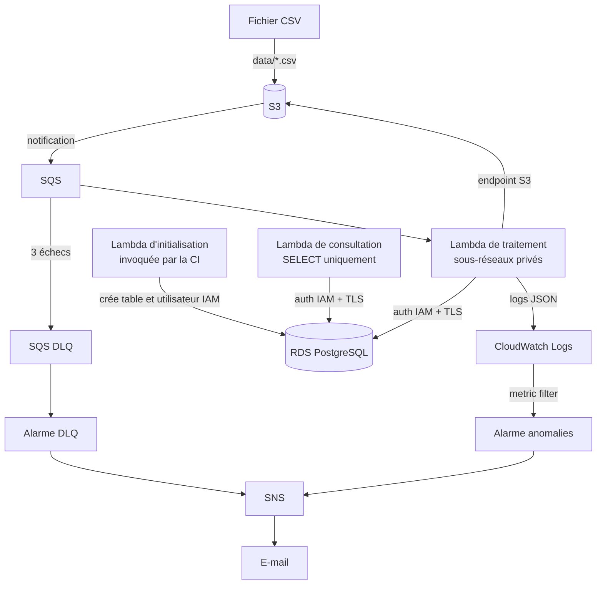
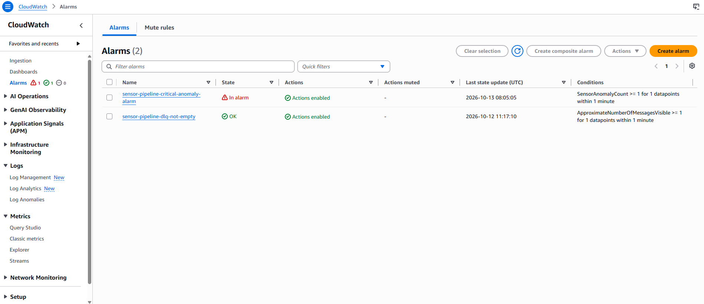
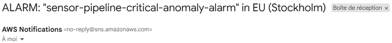
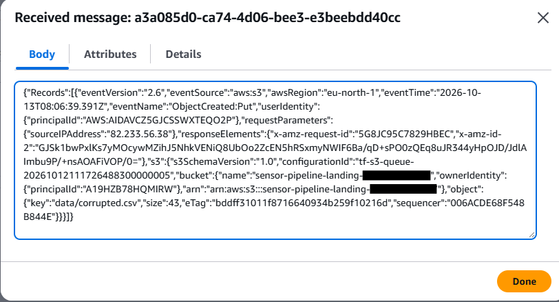
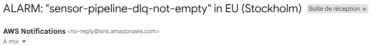
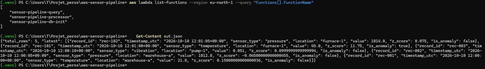

# Pipeline événementiel d'ingestion de capteurs IoT (AWS + Terraform)

[](https://github.com/petdroo/aws-sensor-pipeline/actions/workflows/deploy.yml)

Projet personnel pour pratiquer l'ingénierie cloud sur AWS. Un fichier CSV de mesures déposé dans S3 est validé, comparé à un référentiel statistique par type de capteur (z-score) et stocké dans PostgreSQL, avec une alerte e-mail en cas d'anomalie ou d'échec. L'ingestion est serverless (S3, SQS, Lambda) et le stockage repose sur une instance RDS. Toute l'infrastructure est décrite en Terraform et déployée par GitHub Actions.

**Stack** : S3, SQS, Lambda (Python 3.12), RDS PostgreSQL 16, VPC, IAM, CloudWatch, SNS, Terraform, GitHub Actions.
**Région** : eu-north-1 (Stockholm).

## Ce que fait le pipeline

1. Un CSV (`record_id`, `timestamp_str`, `sensor_type`, `raw_value`, `location`) est déposé dans `data/` du bucket S3.
2. S3 notifie une file SQS, qui déclenche la Lambda de traitement (`sensor-pipeline-processor`).
3. La Lambda valide le fichier, normalise les dates en UTC, calcule un z-score par rapport à la moyenne et à l'écart-type de référence du type de capteur, puis insère les lignes dans RDS en une seule transaction.
4. Une mesure avec |z| ≥ 3 est marquée comme anomalie et déclenche un e-mail (log JSON, metric filter, alarme CloudWatch, SNS).
5. Un fichier invalide est réessayé 3 fois, puis placé dans une Dead-Letter Queue (DLQ) qui déclenche aussi un e-mail.

Deux autres Lambdas, déclenchées à la demande, complètent le projet :

- `sensor-pipeline-db-init` crée la table `sensor_metrics` et l'utilisateur de base `lambda_user` (authentification IAM). La CI l'invoque après chaque `apply`.
- `sensor-pipeline-query` interroge la table et renvoie le nombre de lignes et les 20 dernières mesures. La base étant privée, c'est le moyen de consulter les données sans bastion ni NAT.

## Architecture



## Choix techniques

- **Événementiel** : SQS entre S3 et Lambda sert de tampon, permet les nouvelles tentatives et isole les messages en échec dans une DLQ.
- **Réseau privé sans NAT** : les Lambdas et RDS sont dans deux sous-réseaux privés (2 zones de disponibilité), sans passerelle Internet. Les Lambdas lisent S3 via un VPC Gateway Endpoint (gratuit), ce qui évite une NAT Gateway payante.
- **Authentification IAM à la base** : les Lambdas de traitement et de consultation se connectent avec un jeton IAM temporaire (`generate_db_auth_token`, valable 15 min) et une connexion TLS vérifiée avec le bundle de certificats RDS. Elles n'utilisent aucun mot de passe. La connexion est conservée entre deux invocations et recréée si elle est périmée.
- **Résilience** : lots de 10 messages avec `ReportBatchItemFailures` (seul le message en échec est rejoué), une transaction par fichier (rollback si une ligne est invalide), visibility timeout de 180 s (6 fois le timeout de 30 s de la Lambda).
- **Idempotence** : SQS livre au moins une fois. `ON CONFLICT (record_id) DO NOTHING` évite les doublons, et l'alerte d'anomalie n'est émise que pour les lignes réellement insérées.
- **Observabilité** : logs JSON structurés (traceback inclus), filtre de métrique, alarme sur les anomalies et alarme séparée sur la DLQ.
- **Coût maîtrisé** : pas de NAT Gateway, Single-AZ, rétention des logs de 7 jours. Seule l'instance RDS est facturée tant que l'infrastructure est déployée, d'où le `destroy` après les tests.

## Limites connues (compromis de démonstration)

- **CI** : la CI utilise un utilisateur IAM avec clés d'accès dans GitHub Secrets (droits administrateur). En production : OIDC et un rôle à droits limités.
- **Mot de passe maître RDS** : généré par Terraform, présent dans le state (bucket S3 privé) et fourni à la seule Lambda d'initialisation, qui crée la table et l'utilisateur IAM. Les Lambdas de traitement et de consultation n'en ont pas besoin. Utiliser Secrets Manager sans NAT exigerait un endpoint VPC payant.
- **Lambda de consultation** : elle ne lance que des `SELECT`, mais elle réutilise le rôle IAM et l'utilisateur de base `lambda_user` du processeur, qui a aussi le droit d'insérer. Elle est donc en lecture seule par construction du code, pas par les privilèges. En production : un rôle et un utilisateur de base dédiés.
- **Infrastructure allégée** : RDS en Single-AZ, clés de chiffrement gérées par AWS (pas de KMS dédié), pas de flow logs ni de X-Ray. Les contrôles Checkov correspondants sont écartés dans `.checkov.yaml`, chacun avec sa justification.
- **Bucket de state** : il est créé à la main avant Terraform (problème de l'œuf et de la poule).
- **Données** : seul le format de date ISO-8601 est géré. La moyenne et l'écart-type de référence par capteur sont fixés dans le code.

**Pour la production** : OIDC, Multi-AZ, Secrets Manager avec rotation, KMS dédié, RDS Proxy, limitation de la concurrence des Lambdas pour protéger les connexions à la base, rôles dédiés par fonction, environnements dev et prod séparés, référentiel statistique configurable.

## Démonstration

**Anomalie critique** : `sample_data/anomaly.csv` simule 45 °C pour un capteur de référence à 21,5 °C (z = 11,75).

| Alarme CloudWatch | E-mail SNS |
| :---: | :---: |
|  |  |

**Fichier corrompu** : `sample_data/corrupted.csv` (en-têtes invalides) est réessayé 3 fois, puis isolé dans la DLQ.

| Message dans la DLQ | E-mail SNS |
| :---: | :---: |
|  |  |

**Données en base** : la Lambda `sensor-pipeline-query` renvoie le nombre de lignes et les dernières mesures, dont l'anomalie (`is_anomaly: true`).



## Qualité et CI/CD

Le workflow `.github/workflows/deploy.yml` comporte deux jobs.

- À chaque push sur `main` et chaque pull request vers `main` :
  - `test-and-lint` : `ruff` (format et lint), `pytest` (10 tests : S3 émulé avec Moto, base de données mockée) et Checkov ;
  - `terraform` : construction du package Lambda (`scripts/build.sh`), puis `terraform fmt`, `validate` et `plan`.
- À la demande (`workflow_dispatch`), avec le choix `plan`, `apply` ou `destroy` :
  - `apply` est suivi de l'initialisation du schéma de la base (invocation de `sensor-pipeline-db-init`) ;
  - `destroy` vide d'abord le bucket S3, puis supprime l'infrastructure.

Un groupe de concurrence évite deux exécutions Terraform simultanées sur le même state.

## Reproduire le projet

Prérequis : compte AWS, AWS CLI configurée sur la région `eu-north-1`, Terraform 1.10 ou plus, dépôt GitHub (fork ou clone).

1. Créer un bucket S3 pour le state Terraform, avec versioning :
   ```bash
   aws s3api create-bucket --bucket <NOM_BUCKET> --region eu-north-1 \
     --create-bucket-configuration LocationConstraint=eu-north-1
   aws s3api put-bucket-versioning --bucket <NOM_BUCKET> \
     --versioning-configuration Status=Enabled
   ```
   Puis remplacer le nom `mon-tfstate-thomas-01` dans `bootstrap/backend.tf` et `terraform/workloads/backend.tf`.
2. Créer l'utilisateur IAM de la CI, puis récupérer ses clés :
   ```bash
   cd bootstrap && terraform init && terraform apply
   terraform output ci_access_key_id
   terraform output -raw ci_secret_access_key
   ```
3. Dans GitHub (**Settings**, **Secrets and variables**, **Actions**), ajouter `AWS_ACCESS_KEY_ID`, `AWS_SECRET_ACCESS_KEY` et `ALERT_EMAIL`.
4. Dans l'onglet **Actions**, lancer **CI/CD Pipeline** avec l'action `apply`. Le workflow construit le package Lambda, déploie l'infrastructure, puis initialise le schéma de la base ; aucune étape locale n'est nécessaire.
5. Confirmer l'abonnement SNS via l'e-mail reçu de AWS, puis déposer un fichier de test :
   ```bash
   ACCOUNT_ID=$(aws sts get-caller-identity --query Account --output text)
   aws s3 cp sample_data/anomaly.csv s3://sensor-pipeline-landing-$ACCOUNT_ID/data/
   ```
6. Consulter les données insérées :
   ```bash
   aws lambda invoke --function-name sensor-pipeline-query --region eu-north-1 out.json
   cat out.json   # PowerShell : Get-Content out.json
   ```
7. Lancer le workflow avec l'action `destroy` pour supprimer les ressources et couper la facturation.

Tests en local :

```bash
python -m venv .venv
source .venv/bin/activate   # Windows : .\.venv\Scripts\Activate.ps1
pip install -r requirements-dev.txt
ruff format --check . && ruff check . && pytest -v
checkov --config-file .checkov.yaml -d terraform/workloads
```

## Structure

```text
src/                   code des Lambdas : traitement (handler.py), initialisation du schéma (db_init.py),
                       consultation (db_query.py) et logger JSON
tests/                 tests Pytest
scripts/build.sh       construction du package Lambda (dépendances + certificats RDS)
terraform/workloads/   infrastructure (réseau, RDS, SQS, Lambda, monitoring)
bootstrap/             utilisateur IAM de la CI
sample_data/           CSV de démonstration (valide, anomalie, corrompu)
docs/images/           captures de la démonstration
.checkov.yaml          contrôles Checkov écartés, avec justification
.github/workflows/     pipeline CI/CD
```
